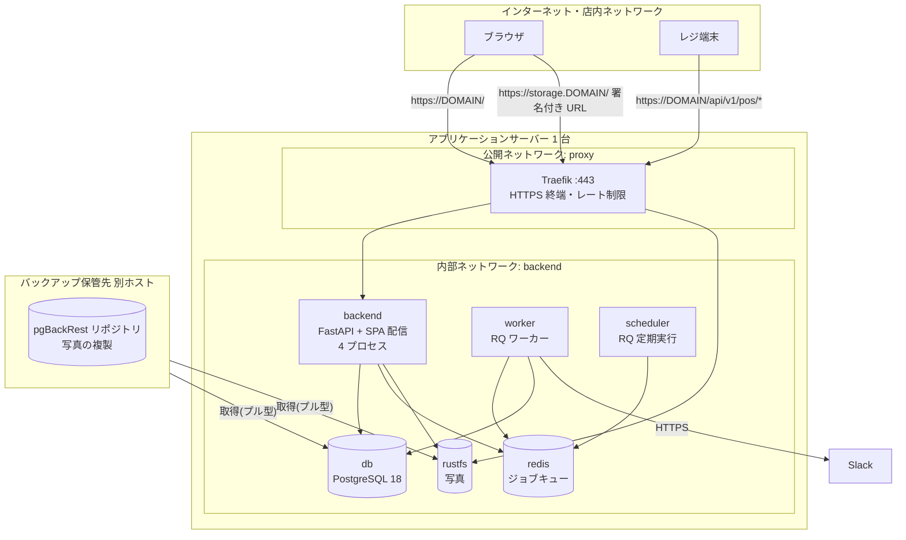
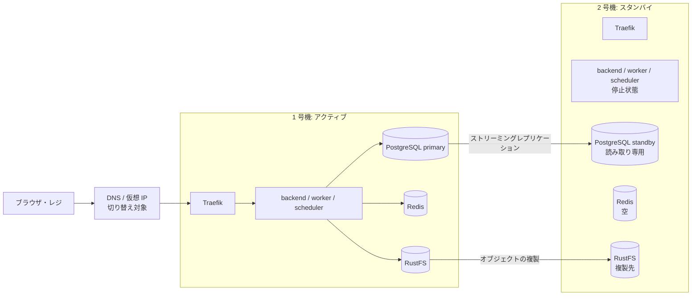

# 技術仕様書 (Architecture Design Document)

> 本書は `docs/product-requirements.md`(PRD)と `docs/functional-design.md`(機能設計書)を、技術的にどう実現するかを定義する。
> 機能設計書で「`docs/architecture.md` で定める」とした項目(ミドルウェアの製品選定、2 台構成、集計の性能対策など)は本書で決定する。

## 設計方針

PRD の制約から、次の 4 点をすべての技術判断の基準とする。

| 方針                         | 内容                                                                                              | 根拠                     |
| ---------------------------- | ------------------------------------------------------------------------------------------------- | ------------------------ |
| OSS のみ                     | ライセンス費用・SaaS 月額費用が発生するものを必須にしない。ライセンスが変わりにくい OSS を選ぶ     | PRD 運用・コスト         |
| テンプレートを活かす         | FastAPI Full Stack Template の構成・規約・ツールを維持し、追加は最小限にする                       | PRD 運用・コスト         |
| 増やすのは 2 つまで          | 追加するミドルウェアはジョブキューとオブジェクトストレージだけにする                              | PRD 運用・コスト         |
| 1 台で始めて 2 台に広げられる | アプリケーションをステートレスに保ち、状態を持つのは DB・ストレージだけにする                     | PRD 信頼性・可用性       |

## テクノロジースタック

### 言語・ランタイム

| 技術       | バージョン               | 選定理由                                                                         |
| ---------- | ------------------------ | -------------------------------------------------------------------------------- |
| Python     | 3.14(`.python-version`) | 既存テンプレートの指定。型ヒントと FastAPI / SQLModel の組み合わせで保守しやすい |
| TypeScript | 6.x                      | 既存テンプレートの指定。OpenAPI から生成する API クライアントで型を共有できる    |
| Bun        | 1.x                      | 既存テンプレートのフロントエンド依存管理・ビルドに使用(`bun.lock`)             |
| uv         | 0.9.x                    | 既存テンプレートの Python 依存管理(`uv.lock`)。Docker ビルドでも使用            |

### フレームワーク・ライブラリ(Backend)

| 技術                 | バージョン         | 用途                                 | 選定理由                                                                                         |
| -------------------- | ------------------ | ------------------------------------ | ------------------------------------------------------------------------------------------------ |
| FastAPI              | 0.141 以上 1.0 未満 | API・SPA の配信                      | 既存。依存性注入で認証・認可・RLS コンテキストを 1 か所に集約できる                              |
| SQLModel             | 0.0.39 以上 1.0 未満 | ORM・スキーマ定義                    | 既存。Pydantic モデルとテーブル定義を共有できる                                                  |
| Alembic              | 1.19 以上 2.0 未満  | DB マイグレーション                  | 既存。RLS ポリシー・DB ロールの権限もマイグレーションで管理する                                  |
| psycopg              | 3.x                | PostgreSQL ドライバ                  | 既存                                                                                             |
| PyJWT / pwdlib       | 既存のまま         | ユーザー認証(JWT・Argon2)          | 既存                                                                                             |
| **RQ**               | 2.x                | ジョブキュー(通知・定期ジョブ)     | Redis プロトコルだけで動き、リトライ(`Retry`)・失敗ジョブ登録簿・定期実行を備える。Celery より設定が少なく、Kafka より運用が軽い |
| **boto3**            | 1.x                | S3 互換ストレージのクライアント      | S3 API の事実上の標準。保存先を S3 互換製品の間で切り替えられる                                  |
| **Pillow**           | 12.x               | 画像の形式検証・メタデータ除去・サムネイル生成 | Python の画像処理の標準的な OSS                                                         |
| httpx                | 既存のまま         | Slack Incoming Webhook への送信      | 既存の依存。タイムアウトを細かく指定できる                                                       |

### フレームワーク・ライブラリ(Frontend)

| 技術                                    | バージョン | 用途                         | 選定理由                                                     |
| --------------------------------------- | ---------- | ---------------------------- | ------------------------------------------------------------ |
| React                                   | 19.x       | UI                           | 既存                                                         |
| TanStack Router / Query / Table         | 既存のまま | ルーティング・取得・表       | 既存。在庫一覧などの並べ替え・絞り込みに Table を使う        |
| Tailwind CSS / Radix UI                 | 既存のまま | スタイル・UI 部品            | 既存                                                         |
| react-hook-form / zod                   | 既存のまま | フォームと入力検証           | 既存                                                         |
| @hey-api/openapi-ts                     | 既存のまま | API クライアント生成         | 既存。Backend の OpenAPI から型付きクライアントを生成する    |
| **Recharts**                            | 3.x        | 売上集計・トレンドのグラフ   | MIT ライセンス。React のコンポーネントとして書け、棒・折れ線・横棒など必要な形式がそろう |

### ミドルウェア

| 技術                       | バージョン                  | 用途                         | 選定理由                                                                                                         |
| -------------------------- | --------------------------- | ---------------------------- | ---------------------------------------------------------------------------------------------------------------- |
| PostgreSQL                 | 18                          | 業務データ                   | 既存。RLS とストリーミングレプリケーションを標準で持つ                                                           |
| Traefik                    | v3.7                        | HTTPS 終端・ルーティング     | 既存。Let's Encrypt の証明書を自動更新し、レート制限・セキュリティヘッダーをミドルウェアで付けられる              |
| **Redis**                  | 8.x                         | RQ のジョブキュー            | RQ が前提とするキュー。依頼者との会話で挙がっており、運用情報も多い。Redis 8 は AGPLv3 を選べる OSS として提供されている(下記の注記を参照) |
| **RustFS**                 | 導入時点の安定版(タグで固定) | 商品写真の保存(S3 互換)    | 依頼者の指定。Apache-2.0 ライセンス。S3 API 互換のため、boto3 から AWS S3 と同じ書き方で使える                    |
| **pgBackRest**             | 2.x                         | DB のバックアップ・復旧      | MIT ライセンス。WAL アーカイブによる任意時点への復旧と、世代管理・暗号化を 1 つのツールで行える                   |

> **Redis のライセンスについて**: Redis 7.4 以降はライセンスが変わり、Redis 8 から RSALv2 / SSPLv1 / AGPLv3 の 3 つから選べる形になった。本システムは AGPLv3 として扱い、**Redis を改変せず、公式イメージをそのまま別コンテナで動かす**。この使い方では、本システムのソースコードに AGPLv3 の公開義務は及ばない。将来ライセンスが再び変わった場合は、Redis 互換の Valkey(BSD ライセンス)へ、接続先の変更だけで移行できる(RQ は両方で動く)。

> **RustFS の成熟度について**: RustFS は比較的新しいプロジェクトである。アプリケーションは boto3 の S3 API だけを使い、RustFS 固有の機能には依存しない。本番運用で問題が出た場合は、設定(エンドポイントと認証情報)の変更だけで SeaweedFS など他の S3 互換 OSS に移行できるようにしておく。

### 開発ツール

| 技術                  | バージョン   | 用途                                   | 選定理由                                       |
| --------------------- | ------------ | -------------------------------------- | ---------------------------------------------- |
| pytest / coverage     | 既存のまま   | Backend のテスト・カバレッジ           | 既存                                           |
| Ruff / mypy / ty      | 既存のまま   | Lint・フォーマット・型チェック         | 既存                                           |
| Biome                 | 2.x          | Frontend の Lint・フォーマット         | 既存                                           |
| Playwright            | 1.62.x       | E2E テスト                             | 既存(`frontend/tests`)                       |
| pre-commit / typos    | 既存のまま   | コミット前チェック                     | 既存                                           |
| **pip-audit**         | 最新         | Python 依存の脆弱性検知                | PyPA が管理する OSS。`uv.lock` から検査できる  |
| **Trivy**             | 最新         | コンテナイメージ・依存の脆弱性検知     | Apache-2.0。OS パッケージと言語依存をまとめて検査できる |
| **Locust**            | 2.x          | 性能試験                               | Python でシナリオを書け、既存の知識で扱える    |
| **GitHub Actions / Dependabot** | -  | CI・依存の自動更新                     | リポジトリが GitHub(開発中はパブリック)にあり、追加費用なしで使える |

## システム構成

### 実行環境の全体像(フェーズ 1: 1 台構成)



### コンテナ一覧

| サービス    | イメージ                  | 公開         | 役割                                                     | 状態の有無             |
| ----------- | ------------------------- | ------------ | -------------------------------------------------------- | ---------------------- |
| proxy       | `traefik:v3.7`            | 80 / 443     | HTTPS 終端、`DOMAIN` → backend、`storage.DOMAIN` → rustfs | 証明書(ボリューム)   |
| backend     | 自前ビルド                | Traefik 経由 | API・SPA 配信。起動前に Alembic を実行                   | なし                   |
| worker      | backend と同じイメージ    | なし         | `rq worker --with-scheduler`(通知の送信・リトライ)     | なし                   |
| scheduler   | backend と同じイメージ    | なし         | 定期ジョブの投入(取り残し通知 1 分ごと、不要写真・監査ログの削除 1 日ごと) | なし        |
| db          | `postgres:18`             | なし         | 業務データ                                               | **あり**               |
| redis       | `redis:8`                 | なし         | ジョブキュー。AOF で永続化するが、失われても DB から復元できる | あり(失われても可) |
| rustfs      | `rustfs/rustfs:<固定タグ>` | Traefik 経由 | 写真の保存。バケットは非公開、署名付き URL のみで読める  | **あり**               |
| adminer / pgadmin / mailpit | 既存          | 開発環境のみ | DB 操作・メール確認                                      | -                      |

- **worker と scheduler は backend と同じイメージ**を使い、起動コマンドだけを変える。業務ロジック(サービスレイヤー)を共有し、デプロイの単位を 1 つに保つ
- **Adminer は本番から外す**。現状の `compose.deploy.yml` は `adminer.DOMAIN` を公開しているが、DB 管理画面をインターネットに出さない。本番での DB 操作は SSH 経由の `psql` で行う
- 定期ジョブは RQ 2.x の定期実行機能で投入する。使う RQ のバージョンで定期実行機能が使えない場合は、`scheduler` を「1 分ごとにジョブを投入するだけの小さな Python プロセス」として実装する(追加ライブラリは入れない)

### ネットワーク分離

| ネットワーク | 参加するサービス                                | 目的                                         |
| ------------ | ----------------------------------------------- | -------------------------------------------- |
| `proxy`      | proxy、backend、rustfs                          | Traefik から公開対象にだけ到達できる         |
| `backend`    | backend、worker、scheduler、db、redis、rustfs    | 内部通信。`internal: true` で外部へ出さない(worker は Slack 送信のため外向き通信を許可する別ネットワークにも参加) |

- ホストのポートとして公開するのは 80 / 443 のみ。db(5432)・redis(6379)・rustfs(9000)は本番ではホストに公開しない

### 開発環境

- `compose.override.yml` に redis・rustfs・worker・scheduler を追加し、`docker compose watch` で全体を起動できるようにする
- rustfs は開発時に `localhost:9000`(S3 API)と `localhost:9001`(管理画面)で公開する。起動時にバケットを作成する初期化コンテナを用意する
- フロントエンドの開発は既存どおり Vite の開発サーバー(`bun run dev`、`VITE_API_URL=http://localhost:8000`)を使う。本番は SPA を backend イメージに同梱して配信する
- Slack は開発環境では送信せず、送信内容をログに出力するダミー実装に切り替える(`SLACK_WEBHOOK_URL` 未設定時)

## アーキテクチャパターン

### Backend のレイヤー構成

```
┌──────────────────────────────────────────┐
│ API レイヤー         app/api/routes        │ ← リクエストの検証・レスポンスの整形
├──────────────────────────────────────────┤
│ 依存性レイヤー       app/api/deps          │ ← 認証・役割の判定・RLS コンテキストの設定
├──────────────────────────────────────────┤
│ サービスレイヤー     app/services          │ ← 業務ルール・トランザクション境界
├──────────────────────────────────────────┤
│ データレイヤー       app/models + Session  │ ← テーブル定義・クエリ
└──────────────────────────────────────────┘
  横断: app/integrations(Slack・ストレージ) / app/jobs(RQ ジョブ) / app/core(設定・DB・セキュリティ)
```

| レイヤー       | 責務                                             | 許可される操作                               | 禁止される操作                                       |
| -------------- | ------------------------------------------------ | -------------------------------------------- | ---------------------------------------------------- |
| API            | 入出力の型変換、HTTP ステータスへの変換          | 依存性・サービスの呼び出し                   | 業務ルールの実装、`Stock.quantity` の直接更新         |
| 依存性         | JWT / API キーの検証、`StoreScope` の決定と設定  | DB セッションの生成、主体の取得              | 業務ルールの実装                                     |
| サービス       | 在庫増減・履歴・アラート判定、コミット           | データレイヤー・integrations・ジョブ投入     | `fastapi` の `Request` / `HTTPException` への依存     |
| データ         | テーブル定義、クエリ                             | DB アクセス                                  | 業務ルールの実装                                     |
| integrations   | 外部サービスとの通信を薄く包む                   | HTTP・S3 API の呼び出し                      | DB アクセス                                          |
| jobs           | RQ から呼ばれる入口。サービスを呼ぶだけ          | サービス・integrations の呼び出し            | 業務ルールの重複実装                                 |

- サービスは独自の例外(`InsufficientStockError` など)を送出し、API レイヤーの例外ハンドラーで HTTP ステータスに変換する。これにより、ワーカーからも同じサービスを使える
- 既存テンプレートの `crud.py` は、ユーザー関連の既存処理に限って残す。新しい業務ロジックは `app/services` に置く

### Frontend の構成

```
routes/(画面・URL) → components/(表示部品) → hooks/(取得・更新) → client/(自動生成 API クライアント)
```

- API 呼び出しは `client/`(openapi-ts の生成物)だけを経由する。手書きの `fetch` は使わない
- 役割によるメニューの出し分けは UI の利便性のためであり、認可は必ず Backend で行う

## データ永続化戦略

### ストレージ方式

| データ種別                 | ストレージ             | 形式                     | 理由                                                         |
| -------------------------- | ---------------------- | ------------------------ | ------------------------------------------------------------ |
| マスタ・在庫・取引・履歴   | PostgreSQL             | テーブル                 | トランザクションと RLS が必要                                |
| 監査ログ                   | PostgreSQL             | テーブル(JSONB 含む)   | 業務データと同じバックアップで守り、検索できる               |
| 商品写真・サムネイル       | RustFS(S3 互換)      | JPEG / PNG / WebP        | DB を大きくしない。2 台構成時も共有しやすい                  |
| ジョブキュー               | Redis                  | RQ の内部形式            | 一時データ。正は DB の `StockAlert`(送信箱)に置く         |
| アプリケーションログ       | Docker のログ(標準出力) | JSON 1 行 1 イベント   | 追加のログ基盤を置かない。`json-file` ドライバでローテーション |
| TLS 証明書                 | Docker ボリューム      | Traefik の `acme.json`   | 既存                                                         |

### DB ロールと接続

| ロール      | 用途                                                          | 権限                                                                                                   |
| ----------- | ------------------------------------------------------------- | ------------------------------------------------------------------------------------------------------ |
| `postgres`  | DB の初期化のみ                                               | スーパーユーザー。アプリケーションからは使わない                                                       |
| `app_owner` | テーブルの所有者。`prestart` で Alembic を実行                | DDL。RLS の対象外                                                                                      |
| `app_user`  | backend・worker・scheduler の実行時接続                       | DML のみ。`BYPASSRLS` なし。`stock_movement` / `audit_log` は `INSERT`・`SELECT` のみ                  |
| `backup`    | pgBackRest                                                    | レプリケーション・バックアップに必要な権限のみ                                                         |

- 接続文字列を 2 つに分ける: `MIGRATION_DATABASE_URL`(`app_owner`)と `DATABASE_URL`(`app_user`)。現状の `DATABASE_URL` は `postgres` で接続しており、RLS が効かないため変更する
- ロールの作成は db コンテナの初期化スクリプト(`docker-entrypoint-initdb.d`)で行い、パスワードは環境変数から渡す
- コネクションプール: backend 1 プロセスあたり `pool_size=5`・`max_overflow=5`(4 プロセスで最大 40)、worker は 5。PostgreSQL の `max_connections` は 100

### バックアップ戦略

ランサムウェア対策として「本番サーバーが乗っ取られても消されないバックアップ」を必ず 1 つ持つ。

| 対象   | 方式                                                                                     | 頻度                                   | 保持                 |
| ------ | ---------------------------------------------------------------------------------------- | -------------------------------------- | -------------------- |
| DB     | pgBackRest。フルバックアップ + WAL の常時アーカイブ(`archive_timeout = 60s`)            | フル: 週 1 回 / 差分: 毎日 / WAL: 随時 | 30 日(任意時点に復旧可能) |
| 写真   | バックアップホストから rclone で差分取得                                                 | 1 日 1 回                              | 30 日(世代を残す)  |
| 設定   | `.env` を暗号化して保管(age などで暗号化し、鍵は別管理)                               | 変更時                                 | 最新 + 直前          |

- **保管先は本番とは別のホスト**とし、**バックアップホストが本番から取得する(プル型)**。本番サーバーはバックアップ保管先への書き込み・削除の権限を持たない
- 加えて **週 1 回、バックアップホストからオフラインの媒体(外付けディスクなど)へ複製**し、ネットワークから切り離して保管する
- pgBackRest のリポジトリは暗号化(`repo1-cipher-type=aes-256-cbc`)する
- **目標**: RPO(失ってよいデータの期間)は約 1 分(WAL アーカイブの間隔)、RTO(復旧までの時間)は 1 台構成で 4 時間以内
- **復旧訓練**: 半年に 1 回、検証用ホストにバックアップから DB と写真を復元し、在庫数と入出庫履歴の合計が一致することを確認する。手順は `docs/` 配下の運用手順書として残す

## 可用性設計(2 台構成への拡張)

### フェーズ 2: ホットスタンバイ構成



| 構成要素       | 2 台構成での扱い                                                                                           |
| -------------- | ---------------------------------------------------------------------------------------------------------- |
| backend など   | ステートレスなので、2 号機でも同じイメージ・同じ設定で起動するだけでよい                                   |
| PostgreSQL     | ストリーミングレプリケーション(非同期)で 2 号機に常時複製する                                           |
| RustFS         | 1 号機から 2 号機へオブジェクトを複製する(RustFS の複製機能、または rclone による 5 分ごとの同期)         |
| Redis          | **複製しない**。切り替え後は空の状態から始め、送信待ちの通知は DB の `StockAlert` から Scheduler が再投入する |
| TLS 証明書     | 2 号機でも Traefik が自動取得する(切り替え後に取得)。事前に証明書ボリュームを複製しておく              |

### 切り替え手順(手動)

1. 1 号機の停止を確認する(両方がアクティブになる「スプリットブレイン」を防ぐため、1 号機のコンテナと DB を確実に止める)
2. 2 号機の PostgreSQL を昇格する(`pg_ctl promote`)
3. 2 号機の backend・worker・scheduler を起動する
4. DNS(または仮想 IP)を 2 号機に向ける
5. 画面からログイン・在庫一覧・販売登録を確認する

- **目標**: 1 台の故障から 30 分以内に業務を再開する(PRD)。手順書に従って手動で切り替える
- **自動切り替え(Patroni など)は採用しない**。合意形成のための etcd などのミドルウェアが増え、少人数での運用に見合わないため。必要になった時点で再検討する
- **フェーズ 1 で守ること**(2 台構成へ作り直しなしで移行するための前提)
  - アプリケーションはローカルディスクにファイルを書かない(写真は RustFS、ログは標準出力)
  - ログイン状態はサーバーに持たない(JWT)
  - 定期ジョブは「同時に 2 つ動いても壊れない」ように作る(冪等にする)
  - 接続先(DB・Redis・ストレージ)はすべて環境変数で指定する

## パフォーマンス要件

### レスポンスタイム

| 操作                                         | 目標                     | 測定方法                                                                      |
| -------------------------------------------- | ------------------------ | ----------------------------------------------------------------------------- |
| 一覧・登録・更新 API                         | 95 パーセンタイル 500ms 以内 | Locust で同時 50 ユーザー、10 分間                                          |
| 販売登録(明細 10 行)                       | 95 パーセンタイル 300ms 以内 | 同上。在庫の条件付き UPDATE と履歴の追記を含む                              |
| 売上集計・トレンド分析(3 年分)             | 3 秒以内                 | 試験データ(20 店舗・5,000 SKU・販売明細 300 万件)で、全店舗・3 年の集計 |
| 在庫アラートの Slack 通知                    | 操作から 1 分以内        | 在庫更新の時刻と Slack の受信時刻の差                                         |
| 写真のアップロード(5MB)                    | 5 秒以内                 | 10Mbps の回線を想定して計測                                                   |

- **測定環境**: 本番と同じ構成のホスト(4 vCPU / 8GB メモリ / SSD)
- **RLS の性能**: ポリシーの条件は `store_id` を先頭にしたインデックスで処理されることを `EXPLAIN` で確認する。RLS の有無で応答時間が 20% 以上悪化する場合はポリシーの書き方を見直す

### 売上集計の性能対策

1. MVP では明細(`sale_line`)から直接集計する
2. MVP の完成時に上記の試験データで性能試験を行い、3 秒を超えた場合に **日次集計テーブル** `daily_sales_summary(store_id, product_id, sales_date, quantity, amount)` を導入する
   - 販売の登録・取消と同じトランザクションで加算・減算する(UPSERT)。集計結果が実データとずれない
   - 月次・年間・トレンドは日次集計テーブルから算出する(3 年分で最大 約 1,100 万行 → インデックス付きで 1 秒未満を見込む)
3. マテリアライズドビュー(定期再計算)は、集計結果に遅れが出るため採用しない

### リソース見積もり

| リソース       | フェーズ 1 の推奨値   | 根拠                                                                                          |
| -------------- | --------------------- | --------------------------------------------------------------------------------------------- |
| CPU            | 4 vCPU                | backend 4 プロセス + worker + PostgreSQL                                                      |
| メモリ         | 8GB                   | PostgreSQL `shared_buffers` 2GB、backend 4 プロセスで約 1GB、その他                           |
| ディスク(DB) | 50GB                  | 販売明細・入出庫履歴が年間 各 100 万件で約 1GB/年。WAL・インデックスを含め 3 年で 10GB 未満、余裕を持たせる |
| ディスク(写真) | 50GB                  | 5,000 SKU × 平均 2MB + サムネイル ≒ 10GB。差し替え前の世代とバックアップの一時領域を含める       |

## セキュリティアーキテクチャ

### 脅威と対策

| 脅威                                   | 対策                                                                                                                                 |
| -------------------------------------- | ------------------------------------------------------------------------------------------------------------------------------------ |
| 店舗間のデータ漏えい                   | RLS(`FORCE`・非所有者ロール `app_user`・設定漏れは 0 件)。RLS 対象の全テーブルを自動テストで検証                                  |
| 不正アクセス(パスワード総当たり)     | Traefik のレート制限(`/api/v1/login/*` は 1 IP あたり 10 回/分)。ログイン失敗を監査ログに記録                                     |
| 盗まれたトークンの悪用                 | アクセストークンの有効期限を 8 日 → **12 時間**に短縮(1 勤務日の長さ)。レジ端末は API キーを端末単位で即時無効化                 |
| ランサムウェア                         | プル型・オフラインのバックアップ(データ永続化戦略)。復旧訓練                                                                      |
| サプライチェーン攻撃                   | ロックファイル(`uv.lock` / `bun.lock`)で依存を固定。CI で pip-audit・`bun audit`・Trivy。本番イメージはダイジェストで固定           |
| 管理画面の露出                         | Adminer / pgAdmin は本番に置かない。RustFS の管理画面(9001)は公開しない                                                           |
| 悪意のあるファイルのアップロード       | Pillow で内容を検証し再エンコード。バケットは非公開                                                                                  |
| 内部ネットワークからの不正なリクエスト | レジを含めて全 API を認証必須にする(店内ネットワークでも信用しない)                                                              |

### 通信の暗号化

- 外部との通信はすべて HTTPS(Traefik が Let's Encrypt で証明書を取得・更新)。HTTP は HTTPS へリダイレクトする(既存の `compose.deploy.yml`)
- Traefik のミドルウェアでセキュリティヘッダーを付与する: `Strict-Transport-Security`(1 年)、`X-Content-Type-Options: nosniff`、`X-Frame-Options: DENY`、`Referrer-Policy: same-origin`、`Content-Security-Policy`(自ドメインと `storage.DOMAIN` の画像のみ許可)
- コンテナ間の内部通信(backend → db など)は内部ネットワークに閉じるため平文とする。2 台構成のレプリケーション通信はホスト間をまたぐため TLS を有効にする

### 機密情報の管理

| 秘密情報                                  | 管理方法                                                         |
| ----------------------------------------- | ---------------------------------------------------------------- |
| `SECRET_KEY`(JWT 署名)                  | `.env`(パーミッション 600)。既存の `changethis` チェックを維持 |
| DB パスワード(ロールごと)               | `.env`。ロールごとに別のパスワード                               |
| `SLACK_WEBHOOK_URL`                       | `.env`。ログ・エラー・監査ログに出力しない                       |
| ストレージのアクセスキー                  | `.env`。backend 用(読み書き)とバックアップ用(読み取りのみ)を分ける |
| レジ端末の API キー                       | DB には SHA-256 のハッシュのみ。平文は発行時に 1 回表示するだけ  |

- `.env` はリポジトリに含めない(既存の `.gitignore`)。暗号化したコピーをバックアップとして別に保管する

### コンテナの堅牢化

- backend イメージは非 root ユーザーで実行する(現状の Dockerfile は root で実行しているため変更する)
- 本番で使うイメージはタグに加えてダイジェスト(`@sha256:...`)で固定し、更新は Dependabot の PR で行う
- 各コンテナにヘルスチェックを設定し、`restart: always` で自動再起動する(既存の方針を全サービスに広げる)

### 監査とログ

- 監査ログ(機能設計書の `AuditLog`)は DB に 1 年保持する
- アプリケーションログは JSON 形式で標準出力に出し、各リクエストにリクエスト ID を付ける。Docker の `json-file` ドライバで 1 ファイル 50MB × 10 世代にローテーションする
- Sentry は既存どおり任意(`SENTRY_DSN` 設定時のみ)。必須の外部サービスにはしない

## スケーラビリティ設計

### データ増加への対応

- **想定データ量**: 店舗 20、商品 5,000 SKU、販売明細・入出庫履歴 各 年間 100 万件(PRD)
- **構成を変えずに対応する範囲**: 上記の 2 倍(PRD)。インデックスと日次集計テーブル(必要時)で対応する
- **それを超える場合の対策**(現時点では実施しない)
  - `sale_line` / `stock_movement` を年単位でパーティション分割する(PostgreSQL の宣言的パーティション)
  - 集計を読み取り専用のスタンバイ DB に逃がす(2 台構成時)
- **アーカイブ**: 業務データは削除しない(在庫の根拠・売上の記録のため)。監査ログのみ 1 年で削除する

### 処理能力の拡張

- backend はプロセス数(`--workers`)を増やすだけで拡張できる(ステートレス)
- 通知が増えた場合は worker のコンテナ数を増やす(RQ のワーカーは複数起動してよい)

### 機能拡張性

- **通知チャネル**: `Notifier` インターフェース(`send(alert)`)の背後に Slack 実装を置く。メールなど他のチャネルは実装の追加で対応できる(現時点ではスコープ外)
- **ストレージ**: `ObjectStorage` インターフェースの背後に S3 互換の実装を置く。RustFS 以外の S3 互換製品へは設定変更で移行する
- **API**: `/api/v1` でバージョンを固定する。レジ連携の API(`/api/v1/pos/*`)は外部の端末が使うため、互換性を壊す変更をするときは `/api/v2` を新設する

## テスト戦略

### ユニットテスト

- **フレームワーク**: pytest
- **対象**: サービスレイヤーの業務ルール(在庫アラートの判定、前年比、期間の区切り、発注のステータス遷移、API キーの検証、画像の検証)
- **カバレッジ目標**: `app/services` で 90% 以上、Backend 全体で 80% 以上

### 統合テスト

- **方法**: Docker Compose で PostgreSQL・Redis・RustFS を起動し、pytest から実物に接続する(モックは Slack のみ)
- **RLS のテスト**: テストも `app_user` で接続する(`postgres` で接続すると RLS が効かず、テストが意味を持たないため)
- **対象**: 機能設計書「テスト戦略 > 統合テスト」の各シナリオ

### E2E テスト

- **ツール**: Playwright(既存の `frontend/tests`)
- **シナリオ**: 機能設計書「テスト戦略 > E2E テスト」の各シナリオ。役割ごと(本部ユーザー・店舗スタッフ)のログイン状態を用意する

### 性能試験

- **ツール**: Locust
- **データ**: 試験データ生成スクリプト(20 店舗・5,000 SKU・3 年分の販売明細 300 万件)
- **時期**: MVP 完成時と、P1 機能の追加時

### CI(GitHub Actions)

| ジョブ           | 内容                                                       | 実行タイミング       |
| ---------------- | ---------------------------------------------------------- | -------------------- |
| lint             | Ruff・mypy・Biome・typos                                    | PR・main への push   |
| test-backend     | Compose で依存を起動し pytest(カバレッジ計測)             | PR・main への push   |
| test-e2e         | Playwright                                                  | PR・main への push   |
| security         | pip-audit・`bun audit`・Trivy(イメージ)                   | PR・毎日             |
| dependabot       | Python・npm・Docker・GitHub Actions の更新 PR               | 毎週                 |

- 現状のリポジトリには CI の設定(`.github/workflows`)がないため、新たに追加する
- 開発中はパブリックリポジトリで運用するため、GitHub Actions の標準ランナーを追加費用なしで使える。非公開に切り替える場合は無料枠(実行時間)の範囲に収まるか確認し、収まらなければ実行するジョブを絞る
- 重大(Critical / High)な脆弱性が見つかった場合は、検知から 2 週間以内に更新する(PRD)

## 技術的制約

### 環境要件

- **OS**: Docker Engine と Docker Compose v2 が動く Linux(Ubuntu 24.04 LTS を推奨)
- **ホスト**: 4 vCPU / 8GB メモリ / SSD 100GB 以上(フェーズ 1)
- **ネットワーク**: 443 番ポートをインターネットから受けられること(Let's Encrypt と外部からの利用)。worker から Slack(`hooks.slack.com`)へ HTTPS で接続できること
- **バックアップ保管先**: 本番とは別のホスト(同じ建物内でも可)と、週 1 回のオフライン媒体。どちらも依頼者が用意する

### パフォーマンス制約

- 同期処理(API の応答)の中で外部サービス(Slack)を呼ばない。必ずジョブに分ける
- 1 回の API で扱う件数に上限を設ける(一覧は最大 500 件、販売明細は 100 行)

### セキュリティ制約

- DB への接続はすべて `app_user`(RLS が効くロール)で行う。`postgres` や `app_owner` での実行時接続を禁止する
- RLS 対象テーブルを追加するときは、マイグレーションで必ず `ENABLE` / `FORCE ROW LEVEL SECURITY` とポリシーを同時に作成し、RLS のテスト対象に加える

## 依存関係管理

| 対象                      | ロックファイル / 固定方法         | バージョン管理方針                                                              |
| ------------------------- | --------------------------------- | ------------------------------------------------------------------------------- |
| Python パッケージ         | `uv.lock`                         | `pyproject.toml` は「メジャー未満」の範囲指定(例: `rq>=2.0,<3.0`)、実際の版は lock で固定 |
| npm パッケージ            | `bun.lock`                        | `package.json` は `^` で範囲指定、実際の版は lock で固定。生成系(openapi-ts)は完全固定 |
| コンテナイメージ          | タグ + ダイジェスト               | メジャー(またはマイナー)のタグを使い、本番はダイジェストで固定               |
| GitHub Actions            | コミット SHA                      | 既存の pre-commit と同じく SHA で固定                                           |

- 更新は Dependabot の PR で行い、CI がすべて通ったものだけをマージする
- 新しい依存を追加するときは、ライセンス(OSS であること、商用利用に制限がないこと)とメンテナンス状況(直近 1 年の更新)を確認する
