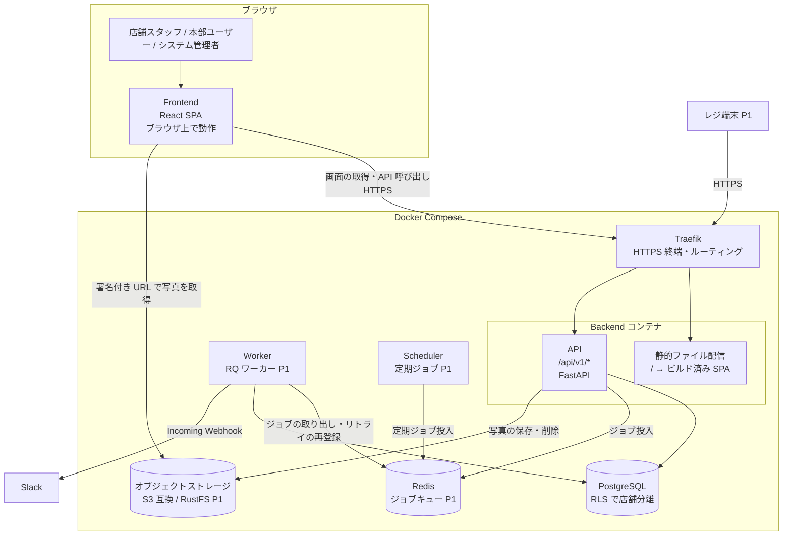
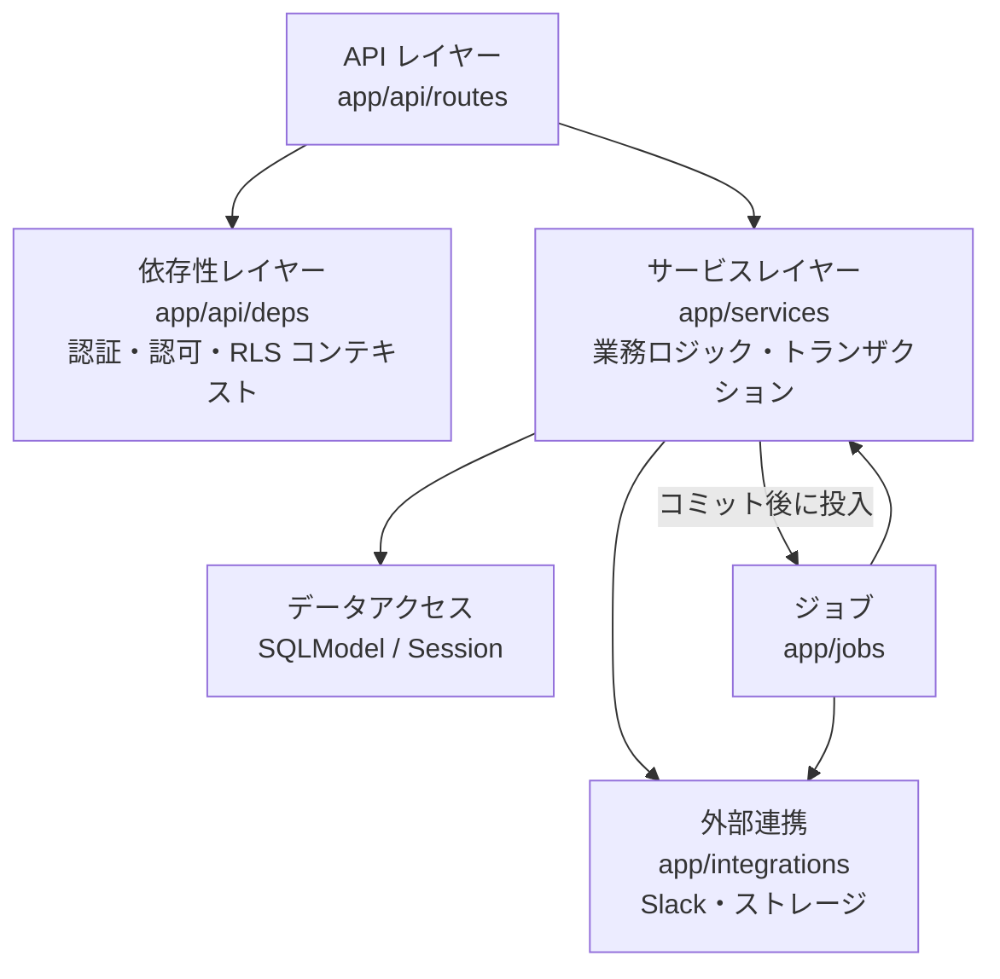
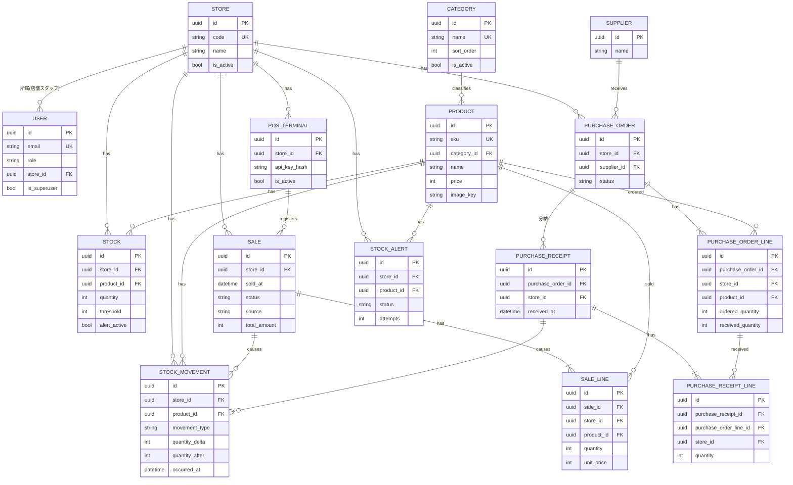
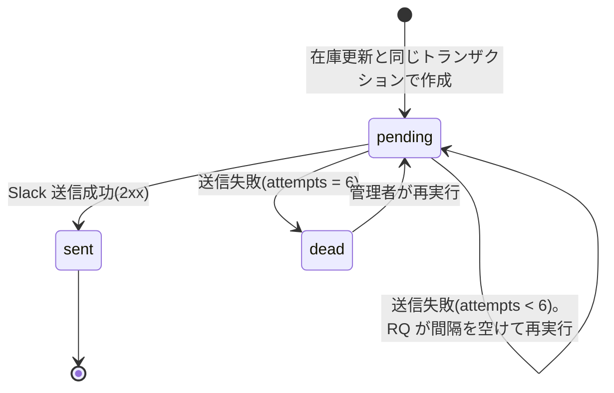
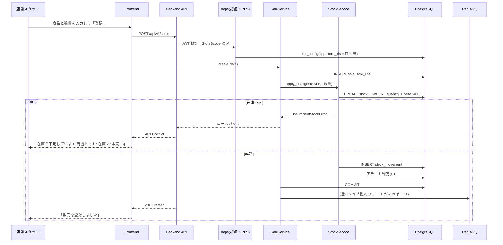
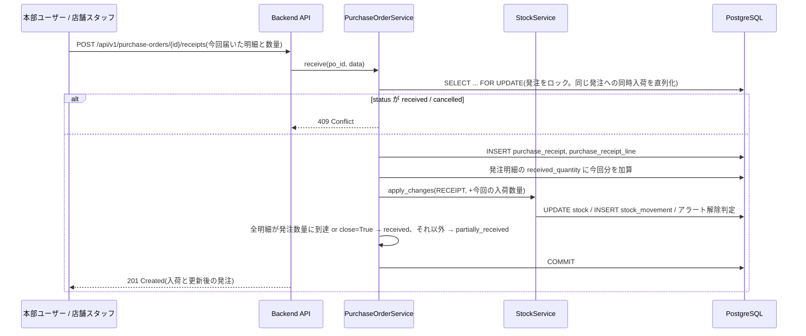
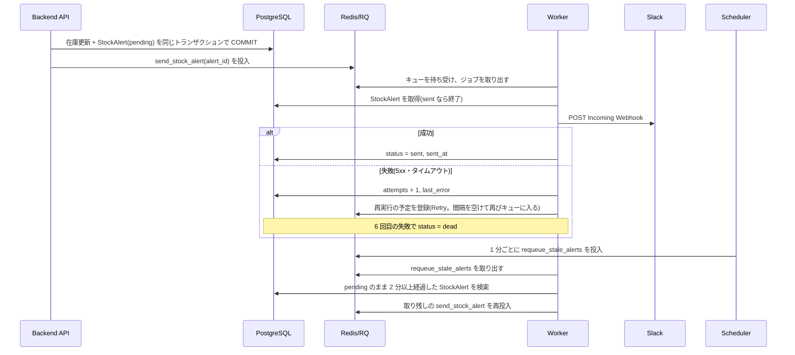
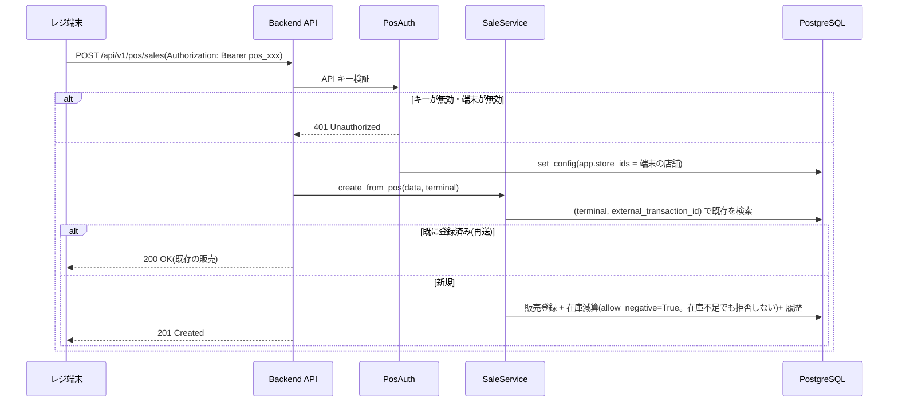
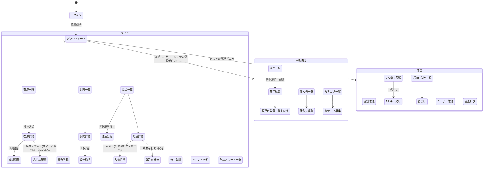

# 機能設計書 (Functional Design Document)

> 本書は `docs/product-requirements.md`(PRD)の機能要件を、どう実現するかに落とし込む。
> 機能番号(機能1〜11)と要求 ID(F-1 など)は PRD と対応する。
> ミドルウェアの製品選定・インフラ構成・2 台構成の詳細は `docs/architecture.md` で定める。本書の選定は機能を実現するための前提として記載する。

## システム構成図



- 矢印は「接続・呼び出しを始める側 → 相手」を表す。Redis から Worker へジョブを送り込むことはなく、Worker が Redis に接続してキューからジョブを取り出す(プル型)
- Scheduler は DB に接続しない。定期ジョブ(取り残し通知の再投入など)を Redis に投入するだけで、実行は Worker が行う

- Frontend は独立したサーバーを持たない。Backend の Docker イメージのビルド時に SPA をビルドし、FastAPI が `/` で静的ファイルとして配信する(既存テンプレートの `app.frontend("/", ...)`)
- ブラウザは SPA を受け取った後、同じオリジンの `/api/v1/*` を Traefik 経由で呼び出す。Frontend のコンテナがリクエストを中継して Backend に渡す構成ではない
- 写真は、ブラウザが署名付き URL で(Traefik 経由で)ストレージから直接取得する

### レイヤー構成(Backend)



- **API レイヤー**: リクエストの検証、レスポンスの整形のみを行う。業務ロジックを持たない
- **依存性レイヤー**: 認証(ユーザー JWT / レジ端末 API キー)、役割の判定、RLS 用のセッション変数の設定を行う
- **サービスレイヤー**: 在庫の増減・履歴記録・アラート判定など、業務ルールとトランザクション境界を持つ
- **ジョブ**: Slack 通知など、画面の応答から切り離す処理を RQ ワーカーで実行する

## 技術スタック

| 分類                     | 技術                                          | 選定理由                                                                  |
| ------------------------ | --------------------------------------------- | ------------------------------------------------------------------------- |
| 言語(Backend)            | Python                                        | 既存テンプレートを活かす                                                  |
| フレームワーク           | FastAPI / SQLModel / Alembic                  | 既存テンプレートを活かす                                                  |
| データベース             | PostgreSQL                                    | 既存テンプレート。RLS をネイティブに持ち、店舗分離を DB で強制できる      |
| ジョブキュー             | Redis + RQ                                    | リトライと失敗ジョブの登録簿を持ち、Kafka より運用が軽い(PRD 運用・コスト) |
| オブジェクトストレージ   | S3 互換ストレージ(開発: RustFS)+ boto3       | S3 API に合わせておけば本番の保存先を後から選べる                         |
| 画像処理                 | Pillow                                        | 画像の形式検証とサムネイル生成                                            |
| 言語・UI(Frontend)       | TypeScript / React / TanStack Router・Query・Table / Tailwind CSS / Radix UI | 既存テンプレートを活かす                                     |
| グラフ描画               | Recharts(候補)                              | React 向けの OSS。最終選定は `docs/architecture.md` で行う                |
| 通知                     | Slack Incoming Webhook                        | 依頼者が既に使っている Slack に、追加費用なしで送れる                     |

## データモデル定義

### 共通方針

- 主キーは UUID(既存テンプレートに合わせる)
- 日時はすべて `timestamptz`(UTC)で保存し、集計・表示では `Asia/Tokyo` に変換する
- 金額は **円単位の整数**(税込)で扱う。税計算はスコープ外
- 店舗に属するデータ(在庫・販売・発注など)はすべて `store_id` を持ち、RLS の対象とする。明細テーブルにも `store_id` を持たせ、親テーブルを JOIN しなくてもポリシーを判定できるようにする
- 業務データは物理削除しない。マスタは `is_active` で無効化し、取引は「取消」で打ち消す

### 列挙型

```python
class UserRole(str, Enum):
    HEADQUARTERS = "headquarters"   # 本部ユーザー: 全店舗を横断
    STORE_STAFF = "store_staff"     # 店舗スタッフ: 所属店舗のみ
# システム管理者は既存の User.is_superuser = True で表す(役割とは独立)

class MovementType(str, Enum):
    SALE = "sale"                   # 販売(減)
    SALE_CANCEL = "sale_cancel"     # 販売取消(増)
    RECEIPT = "receipt"             # 入荷(増)
    ADJUSTMENT = "adjustment"       # 棚卸調整(増減)
    TRANSFER_OUT = "transfer_out"   # 店舗間移動・出(P2)
    TRANSFER_IN = "transfer_in"     # 店舗間移動・入(P2)

class SaleStatus(str, Enum):
    COMPLETED = "completed"
    CANCELLED = "cancelled"

class SaleSource(str, Enum):
    MANUAL = "manual"               # 画面からの手入力
    POS = "pos"                     # レジ連携(P1)

class PurchaseOrderStatus(str, Enum):
    ORDERED = "ordered"                         # 発注済み(入荷 0 件)
    PARTIALLY_RECEIVED = "partially_received"   # 一部入荷(分納の途中)
    RECEIVED = "received"                       # 入荷済み(全数入荷、または残数を打ち切って締めた)
    CANCELLED = "cancelled"                     # 取消

class StockAlertStatus(str, Enum):
    PENDING = "pending"             # 送信待ち・リトライ中
    SENT = "sent"                   # 送信完了
    DEAD = "dead"                   # リトライ上限に達した(デッドレター)
```

### エンティティ: Store(店舗)— 機能1

```python
class Store:
    id: UUID
    code: str               # 店舗コード。1-20 文字、英数字とハイフン。一意
    name: str               # 店舗名。1-100 文字
    address: str | None     # 住所。255 文字まで
    is_active: bool         # False で無効化(新規の販売・発注を受け付けない)
    created_at: datetime
    updated_at: datetime
```

**制約**: `code` は一意。店舗自体は RLS の対象外(店舗名の表示に使うため全員が参照できる)。登録・編集はシステム管理者のみ。

### エンティティ: User(ユーザー)— 機能1(既存モデルを拡張)

```python
class User:                 # 既存: id, email, hashed_password, full_name, is_active, is_superuser, created_at
    role: UserRole          # 追加: 本部ユーザー / 店舗スタッフ
    store_id: UUID | None   # 追加: 所属店舗。STORE_STAFF の場合は必須、HEADQUARTERS の場合は NULL
```

**制約**:
- `role = store_staff` のとき `store_id` は NOT NULL(CHECK 制約)
- 既存のサインアップ(`/signup`)は無効化し、ユーザーはシステム管理者が作成する
- 既存の `Item` モデルと関連画面は、商品マスタ(Product)に置き換えて削除する

### エンティティ: Category(カテゴリ)— 機能2

```python
class Category:
    id: UUID
    name: str               # カテゴリ名。1-50 文字。一意
    description: str | None # 説明。255 文字まで
    sort_order: int         # 一覧・選択肢の表示順(昇順)。既定 0
    is_active: bool         # False で無効化(新しい商品には選べない。既存商品の参照は残る)
    created_at: datetime
    updated_at: datetime
```

**制約**: `name` は一意。全店舗共通のため RLS の対象外。登録・編集は本部ユーザーとシステム管理者のみ。商品から参照されているカテゴリは削除できない(無効化のみ)。

### エンティティ: Product(商品マスタ)— 機能2・7

```python
class Product:
    id: UUID
    sku: str                    # 1-50 文字、英数字とハイフン。一意
    name: str                   # 商品名。1-200 文字
    category_id: UUID | None    # FK → Category。未分類は NULL
    description: str | None     # 説明。1000 文字まで
    price: int                  # 販売価格(円・税込)。0 以上
    image_key: str | None       # 写真のオブジェクトキー(P1)
    thumbnail_key: str | None   # サムネイルのオブジェクトキー(P1)
    is_active: bool
    created_at: datetime
    updated_at: datetime
```

**制約**: `sku` は一意。全店舗共通のため RLS の対象外。登録・編集は本部ユーザーとシステム管理者のみ。

### エンティティ: Stock(在庫)— 機能2・8

```python
class Stock:
    id: UUID
    store_id: UUID          # FK → Store
    product_id: UUID        # FK → Product
    quantity: int           # 現在庫数。レジからの販売(P1)に限りマイナスになりうる
    threshold: int | None   # 通知しきい値(P1)。NULL は通知しない
    alert_active: bool      # しきい値を下回って通知済みの状態か(重複通知の防止に使う)
    updated_at: datetime
```

**制約**:
- `(store_id, product_id)` は一意
- マイナス在庫を防ぐ判定は在庫サービスで行う(DB の CHECK 制約は付けない)。画面からの操作はマイナスになる場合エラー、レジからの販売だけはマイナスを許す
- 店舗・商品を登録したとき、全「店舗 × 商品」の組み合わせに `quantity = 0` の行を作成する(20 店舗 × 5,000 SKU = 10 万行)
- `quantity` は API から直接更新できない。在庫サービス(後述)だけが更新する

### エンティティ: StockMovement(入出庫履歴)— 機能5

```python
class StockMovement:
    id: UUID
    store_id: UUID
    product_id: UUID
    movement_type: MovementType
    quantity_delta: int             # 増減数(減は負数)。0 以外
    quantity_after: int             # 操作後の在庫数
    reason: str | None              # 棚卸調整の理由など。255 文字まで
    sale_id: UUID | None            # 販売・販売取消のとき
    purchase_receipt_id: UUID | None  # 入荷のとき(どの回の入荷か)
    actor_user_id: UUID | None      # 操作したユーザー
    actor_terminal_id: UUID | None  # 操作したレジ端末(P1)
    occurred_at: datetime
```

**制約**:
- 追記のみ。アプリケーション用の DB ロールには `INSERT` と `SELECT` だけを許可し、`UPDATE` / `DELETE` を許可しない
- `actor_user_id` と `actor_terminal_id` のどちらか一方が NOT NULL(CHECK 制約)
- インデックス: `(store_id, product_id, occurred_at)`、`(store_id, occurred_at)`

### エンティティ: Sale / SaleLine(販売)— 機能3・6・9・10

```python
class Sale:
    id: UUID
    store_id: UUID
    sold_at: datetime                       # 販売日時
    status: SaleStatus
    source: SaleSource
    total_amount: int                       # 明細の金額合計(円)
    pos_terminal_id: UUID | None            # レジ連携のとき(P1)
    external_transaction_id: str | None     # レジ側の取引 ID(P1)。100 文字まで
    created_by_user_id: UUID | None
    cancelled_at: datetime | None
    cancelled_by_user_id: UUID | None
    cancel_reason: str | None
    created_at: datetime

class SaleLine:
    id: UUID
    sale_id: UUID       # FK → Sale
    store_id: UUID      # RLS 判定用に Sale と同じ値を持つ
    product_id: UUID
    quantity: int       # 1 以上
    unit_price: int     # 販売単価(円)。0 以上
    amount: int         # quantity × unit_price
```

**制約**:
- 1 回の販売の明細は 1〜100 行。同じ商品を複数行に分けない(登録時にまとめる)
- `(pos_terminal_id, external_transaction_id)` は一意(レジの再送による二重登録の防止)
- 取消は販売単位で行う(明細の一部取消はしない)。取消済みの販売は再取消できない
- インデックス: `Sale(store_id, sold_at)`、`SaleLine(store_id, product_id)`

### エンティティ: Supplier(仕入先)— 機能4

```python
class Supplier:
    id: UUID
    name: str               # 1-100 文字
    contact: str | None     # 担当者・電話番号・メールなど。255 文字まで
    is_active: bool
    created_at: datetime
    updated_at: datetime
```

**制約**: 全店舗共通のため RLS の対象外。登録・編集は本部ユーザーとシステム管理者のみ。

### エンティティ: PurchaseOrder / PurchaseOrderLine(発注)— 機能4

```python
class PurchaseOrder:
    id: UUID
    store_id: UUID              # 入荷先の店舗
    supplier_id: UUID
    status: PurchaseOrderStatus
    ordered_at: datetime
    expected_at: date | None    # 入荷予定日
    completed_at: datetime | None   # 入荷済みになった日時
    cancelled_at: datetime | None
    note: str | None            # 255 文字まで
    created_by_user_id: UUID
    created_at: datetime
    updated_at: datetime

class PurchaseOrderLine:
    id: UUID
    purchase_order_id: UUID
    store_id: UUID              # RLS 判定用
    product_id: UUID
    ordered_quantity: int       # 1 以上
    received_quantity: int      # これまでの入荷数量の累計。0 以上(入荷のたびに加算)

class PurchaseReceipt:          # 1 回分の入荷
    id: UUID
    purchase_order_id: UUID
    store_id: UUID              # RLS 判定用
    received_at: datetime
    received_by_user_id: UUID
    note: str | None            # 255 文字まで(「残りは来週」など)

class PurchaseReceiptLine:
    id: UUID
    purchase_receipt_id: UUID
    purchase_order_line_id: UUID
    store_id: UUID              # RLS 判定用
    product_id: UUID
    quantity: int               # 今回の入荷数量。1 以上
```

**制約**:
- ステータスの遷移

  ```mermaid
  stateDiagram-v2
      [*] --> ordered: 発注登録
      ordered --> partially_received: 入荷(全明細の累計が発注数量に届かない)
      ordered --> received: 入荷(全明細が発注数量に到達)
      partially_received --> partially_received: 追加の入荷(まだ届かない)
      partially_received --> received: 追加の入荷(到達)/ 残数を打ち切って締める
      ordered --> cancelled: 取消
      partially_received --> cancelled: 取消(入荷済みの分は在庫に残す)
  ```

- 1 回の入荷では、発注明細の一部だけを指定してよい(指定しない明細は今回 0 個)
- 発注数量を超える入荷も記録できる(超過分も在庫に加算する)
- `received` / `cancelled` の発注には入荷を登録できない
- 入荷の取消はしない。誤入荷は棚卸調整で正す

### エンティティ: PosTerminal(レジ端末)— 機能10(P1)

```python
class PosTerminal:
    id: UUID
    store_id: UUID
    name: str                   # 端末名。1-100 文字
    api_key_prefix: str         # API キーの先頭 8 文字(識別・表示用)
    api_key_hash: str           # API キー全体の SHA-256 ハッシュ
    is_active: bool             # False で即時に無効化
    last_used_at: datetime | None
    created_at: datetime
```

**制約**: API キーは発行時に 1 回だけ画面に表示し、平文は保存しない。

### エンティティ: StockAlert(在庫アラート)— 機能8(P1)

```python
class StockAlert:
    id: UUID
    store_id: UUID
    product_id: UUID
    quantity: int               # 検知時の在庫数
    threshold: int              # 検知時のしきい値
    status: StockAlertStatus
    attempts: int               # 送信を試みた回数
    last_error: str | None      # 直近の失敗理由
    created_at: datetime
    sent_at: datetime | None
```

**用途**: 通知の「送信箱(アウトボックス)」。在庫の更新と同じトランザクションで作成し、Redis の状態に関係なく送信漏れを検知・再送できるようにする。`status = dead` の行がデッドレターキューの一覧になる。

### エンティティ: AuditLog(監査ログ)— 非機能要件

```python
class AuditLog:
    id: UUID
    actor_user_id: UUID | None
    actor_terminal_id: UUID | None
    action: str             # 例: "login.success", "login.failure", "sale.create", "user.role.update"
    target_type: str | None # 例: "sale", "user"
    target_id: UUID | None
    store_id: UUID | None
    detail: dict            # JSONB。変更前後の値など(パスワード等の秘密情報は含めない)
    ip_address: str | None
    occurred_at: datetime
```

**制約**: 追記のみ(StockMovement と同じ権限設定)。1 年を超えた行は定期ジョブで削除する。閲覧はシステム管理者のみ。

### ER図



## コンポーネント設計

### 店舗コンテキスト(StoreContext)— 機能1

**責務**:
- 認証済みの主体(ユーザー / レジ端末)から、アクセスできる店舗の範囲を決める
- リクエストごとの DB トランザクションの開始時に、RLS 用のセッション変数を設定する

**インターフェース**:

```python
@dataclass(frozen=True)
class StoreScope:
    all_stores: bool            # True: 全店舗(本部ユーザー・システム管理者・ワーカー)
    store_ids: list[UUID]       # all_stores=False のときのアクセス可能店舗

def resolve_scope(principal: User | PosTerminal) -> StoreScope: ...
def apply_scope(session: Session, scope: StoreScope) -> None: ...
    # set_config('app.all_stores', 'on' | 'off', true)
    # set_config('app.store_ids', '{uuid,...}', true)
```

**依存関係**: `app/api/deps.py`(`get_db` を拡張し、`after_begin` イベントで毎トランザクション `apply_scope` を呼ぶ)

### 在庫サービス(StockService)— 機能2・3・4・5・8

**責務**:
- 在庫数を変更する唯一の入口。在庫の増減・履歴の記録・アラート判定を同じトランザクションで行う
- 同時に同じ在庫を更新しても数量がずれないようにする

**インターフェース**:

```python
@dataclass
class StockChange:
    store_id: UUID
    product_id: UUID
    delta: int                  # 増減数(減は負数)
    movement_type: MovementType
    reason: str | None = None
    sale_id: UUID | None = None
    purchase_receipt_id: UUID | None = None
    allow_negative: bool = False    # True はレジからの販売のみ

class StockService:
    def apply_changes(self, session: Session, changes: list[StockChange], actor: Actor) -> list[StockMovement]: ...
        # allow_negative=False の変更で在庫が不足するとき InsufficientStockError を送出(トランザクションはロールバック)
    def adjust_to(self, session: Session, store_id: UUID, product_id: UUID,
                  counted_quantity: int, reason: str, actor: Actor) -> StockMovement: ...
        # 棚卸調整: 実数との差分を ADJUSTMENT として記録
    def set_threshold(self, session: Session, store_id: UUID, product_id: UUID, threshold: int | None) -> Stock: ...
```

**依存関係**: StockAlertService(アラート判定)

### 販売サービス(SaleService)— 機能3・10

**インターフェース**:

```python
class SaleService:
    def create(self, session: Session, data: SaleCreate, actor: Actor) -> Sale: ...
    def cancel(self, session: Session, sale_id: UUID, reason: str, actor: Actor) -> Sale: ...
    def create_from_pos(self, session: Session, data: PosSaleCreate, terminal: PosTerminal) -> tuple[Sale, bool]: ...
        # 戻り値の bool は新規作成か(False: 同じ取引 ID の再送で既存を返した)
```

**依存関係**: StockService

### 発注サービス(PurchaseOrderService)— 機能4

**インターフェース**:

```python
class PurchaseOrderService:
    def create(self, session: Session, data: PurchaseOrderCreate, actor: Actor) -> PurchaseOrder: ...
    def receive(self, session: Session, po_id: UUID, data: PurchaseOrderReceive, actor: Actor) -> PurchaseReceipt: ...
        # 1 回分の入荷を登録する。data.close=True なら残数を打ち切って received にする
    def close(self, session: Session, po_id: UUID, actor: Actor) -> PurchaseOrder: ...
        # 入荷を登録せずに残数を打ち切る(partially_received → received)
    def cancel(self, session: Session, po_id: UUID, actor: Actor) -> PurchaseOrder: ...
```

**依存関係**: StockService

### 売上分析サービス(SalesAnalyticsService)— 機能6・9

**インターフェース**:

```python
class SalesAnalyticsService:
    def monthly(self, session: Session, year: int, filters: SalesFilter) -> list[MonthlySales]: ...
    def yearly(self, session: Session, from_year: int, to_year: int, filters: SalesFilter) -> list[YearlySales]: ...
    def by_store(self, session: Session, period: DateRange, filters: SalesFilter) -> list[StoreSales]: ...
    def ranking(self, session: Session, period: DateRange, filters: SalesFilter,
                order_by: Literal["amount", "quantity"], direction: Literal["top", "bottom"], limit: int) -> list[ProductSales]: ...
    def trend(self, session: Session, period: DateRange, granularity: Literal["day", "week", "month"],
              filters: SalesFilter) -> list[TrendPoint]: ...
    def unsold_products(self, session: Session, period: DateRange, filters: SalesFilter) -> list[Product]: ...
```

**依存関係**: なし(読み取りのみ。RLS により店舗スタッフは自店舗分だけが集計される)

### 商品写真サービス(ProductImageService)— 機能7(P1)

**インターフェース**:

```python
class ProductImageService:
    def upload(self, session: Session, product_id: UUID, file: UploadFile) -> Product: ...
    def delete(self, session: Session, product_id: UUID) -> Product: ...
    def presigned_url(self, key: str, expires_in: int = 900) -> str: ...
```

**依存関係**: ObjectStorage(S3 互換クライアントの薄いラッパー: `put` / `delete` / `presigned_get`)

### 在庫アラートサービス(StockAlertService)とジョブ — 機能8(P1)

**インターフェース**:

```python
class StockAlertService:
    def evaluate(self, session: Session, stock: Stock) -> StockAlert | None: ...  # 在庫更新直後に呼ぶ
    def retry_dead(self, session: Session, alert_id: UUID) -> StockAlert: ...      # 管理者による再実行

# app/jobs/notifications.py
def send_stock_alert(alert_id: UUID) -> None: ...      # RQ ワーカーで実行
def requeue_stale_alerts() -> int: ...                 # Scheduler から 1 分ごとに実行
```

**依存関係**: SlackNotifier(Incoming Webhook への POST)、Redis / RQ

### レジ端末認証(PosAuth)— 機能10(P1)

**インターフェース**:

```python
def issue_api_key(session: Session, terminal: PosTerminal) -> str: ...   # "pos_<prefix8>_<secret32>" を返す
def get_current_terminal(session: SessionDep, authorization: str) -> PosTerminal: ...  # FastAPI 依存関数
```

## アルゴリズム設計

### 店舗分離(RLS)

**目的**: アプリケーションのクエリに店舗条件が抜けていても、他店舗の行を返さない。

#### DB ロール

| ロール         | 用途                                | RLS               |
| -------------- | ----------------------------------- | ----------------- |
| `app_owner`    | テーブルの所有者。Alembic での移行  | 対象外(所有者)   |
| `app_user`     | Backend・Worker の接続ユーザー      | 対象(`BYPASSRLS` なし) |

- 現状は Backend が `POSTGRES_USER`(スーパーユーザー)で接続しており、この状態では RLS が効かない。接続ユーザーを `app_user` に分ける
- 対象テーブルには `ENABLE ROW LEVEL SECURITY` と `FORCE ROW LEVEL SECURITY` を設定する

#### ポリシー

対象テーブル: `stock`, `stock_movement`, `sale`, `sale_line`, `purchase_order`, `purchase_order_line`, `purchase_receipt`, `purchase_receipt_line`, `pos_terminal`, `stock_alert`

```sql
CREATE POLICY store_isolation ON stock
    USING (
        current_setting('app.all_stores', true) = 'on'
        OR store_id = ANY (string_to_array(current_setting('app.store_ids', true), ',')::uuid[])
    )
    WITH CHECK (
        current_setting('app.all_stores', true) = 'on'
        OR store_id = ANY (string_to_array(current_setting('app.store_ids', true), ',')::uuid[])
    );
```

#### 店舗範囲の決定

| 主体                     | `app.all_stores` | `app.store_ids`      |
| ------------------------ | ---------------- | -------------------- |
| システム管理者           | on               | -                    |
| 本部ユーザー             | on               | -                    |
| 店舗スタッフ             | off              | 所属店舗の ID        |
| レジ端末                 | off              | 紐づいた店舗の ID    |
| Worker・Scheduler        | on               | -                    |
| 未設定(設定漏れ)       | (NULL)           | (NULL)               |

- **設定漏れは「0 件」になる(フェイルクローズ)**: どちらの変数も未設定なら、ポリシーの条件は真にならず行は返らない
- セッション変数は `set_config(..., true)`(トランザクション内のみ有効)で設定する。コネクションプールで別のリクエストに値が引き継がれない
- SQLAlchemy の `Session` は commit のたびに新しいトランザクションを始めるため、`after_begin` イベントで毎回設定する
- 他店舗の ID を指定した取得・更新は、RLS により「行が存在しない」ため 404 になる(PRD 機能1)

### 在庫の更新(StockService.apply_changes)

**目的**: 同時に販売・入荷が行われても在庫数がずれず、画面からの操作ではマイナスにならない。

1. `changes` を `(store_id, product_id)` でまとめ、`product_id` の昇順に並べる(複数の行をロックする順序をそろえ、デッドロックを防ぐ)
2. 各在庫を条件付きで原子的に更新する

   ```sql
   UPDATE stock
      SET quantity = quantity + :delta, updated_at = now()
    WHERE store_id = :store_id AND product_id = :product_id
      AND (:allow_negative OR :delta >= 0 OR quantity + :delta >= 0)
   RETURNING id, quantity, threshold, alert_active;
   ```

3. 更新が 0 行なら `InsufficientStockError`(商品・現在庫数・要求数を含む)を送出し、トランザクション全体をロールバックする。`allow_negative = True`(レジからの販売)は常に更新され、在庫がマイナスになりうる
4. `StockMovement` を追記する(`quantity_after` は RETURNING の値)
5. `StockAlertService.evaluate` を呼ぶ(P1。MVP では何もしない)
6. 呼び出し元のサービスがコミットする

### 在庫アラートの判定(StockAlertService.evaluate)— P1

**目的**: しきい値を下回った瞬間に 1 回だけ通知し、下回ったままの間は重複通知しない。

| 条件                                                        | 処理                                                            |
| ----------------------------------------------------------- | --------------------------------------------------------------- |
| `threshold` が NULL                                         | 何もしない                                                      |
| `quantity < threshold` かつ `alert_active = false`          | `alert_active = true` にし、`StockAlert(status=pending)` を作成 |
| `quantity < threshold` かつ `alert_active = true`           | 何もしない(通知済み)                                          |
| `quantity >= threshold` かつ `alert_active = true`          | `alert_active = false` に戻す(次に下回ったら再び通知)         |

- しきい値を変更したときも同じ判定を行う
- `StockAlert` は在庫更新と同じトランザクションで作成する。コミット後に `send_stock_alert` を RQ に投入する

### 通知の送信・リトライ・デッドレター — P1



- 初回 + 自動再送 5 回 = 最大 6 回送信を試みる。再送間隔は 10 秒・30 秒・1 分・2 分・5 分(RQ の `Retry(max=5, interval=[10, 30, 60, 120, 300])`)
- 最終失敗時は RQ の失敗コールバックで `status = dead` にする。RQ の失敗ジョブ登録簿は補助とし、**デッドレターの正は `StockAlert` テーブル**とする(Redis のデータが失われても一覧と再実行ができる)
- **送信漏れの救済**: コミット後のジョブ投入が失敗した(Redis 停止など)場合に備え、Scheduler が 1 分ごとに `requeue_stale_alerts` ジョブを投入し、Worker が「`pending` のまま 2 分以上経過し、RQ にジョブがない」行を再投入する
- ワーカーは送信前に `status` を確認し、`sent` なら何もしない(同じ通知の二重送信を防ぐ)
- 4xx 応答(Webhook URL の誤りなど)は再送しても回復しないため、即座に `dead` にする
- 通知文の例:

  ```
  :warning: 在庫がしきい値を下回りました
  店舗: 駅前店(S001)
  商品: 有機トマト 300g(SKU: VEG-0012)
  現在庫: 3 / しきい値: 5
  ```

### 売上の集計(SalesAnalyticsService)

**目的**: 月次・年間・店舗別の売上と、商品のトレンドを算出する。

- **集計対象**: `status = completed` の `Sale` に属する `SaleLine`(取消済みは除く)
- **売上金額**: `SUM(sale_line.amount)`、**販売数量**: `SUM(sale_line.quantity)`
- **期間の区切り**: `sold_at AT TIME ZONE 'Asia/Tokyo'` を `date_trunc('day' | 'week' | 'month' | 'year', ...)` で区切る。週は月曜始まり
- **前年比**: `(当年 - 前年) / 前年 × 100`(%、小数第 1 位で四捨五入)。前年が 0 の場合は表示しない
- **売れていない商品**: 有効な商品のうち、指定期間に `SaleLine` が 1 件もない商品
- **店舗スタッフの場合**: RLS により自店舗分だけが集計される。店舗別の比較は表示しない
- **性能**: MVP は明細から直接集計する(インデックス `Sale(store_id, sold_at)`)。3 年分で 3 秒を超える場合は、日次集計テーブル(店舗 × 商品 × 日)を導入する。導入の判断は `docs/architecture.md` で行う

### 商品写真のアップロード(ProductImageService.upload)— P1

1. サイズを確認する(5MB を超えたら 413)
2. Pillow で画像として開き、形式が JPEG / PNG / WebP であることを内容から確認する(拡張子・Content-Type は信用しない)
3. EXIF などのメタデータを除去して保存し直す(位置情報などの漏えい防止)
4. 長辺 200px のサムネイル(WebP)を生成する
5. 新しいキー `products/{product_id}/{uuid}.{ext}` と `.../{uuid}_thumb.webp` でストレージに保存する(上書きしない)
6. `Product.image_key` / `thumbnail_key` を更新してコミットする
7. コミット後に古いオブジェクトを削除する。削除に失敗した場合は、日次の定期ジョブが「DB から参照されていないオブジェクト」を削除する
- 画面への配信は、有効期限 15 分の署名付き URL で行う(バケットは非公開)

### レジ連携の認証と二重登録防止 — P1

- **API キー形式**: `pos_<prefix 8 文字>_<secret 32 文字>`(`secrets.token_urlsafe` で生成)
- **認証**: `Authorization: Bearer <API キー>`。prefix で端末を引き、キー全体の SHA-256 を `hmac.compare_digest` で比較する。`is_active = false` の端末、または紐づく店舗が無効の端末は 401
- **二重登録防止**: `(pos_terminal_id, external_transaction_id)` の一意制約。同じ取引 ID の再送は、既存の販売を `200 OK` で返す(新規作成時は `201 Created`)

## ユースケース図

### 販売の登録(機能3)



### 発注の入荷処理(機能4)



### 在庫アラートの Slack 通知(機能8・P1)



### レジからの販売登録(機能10・P1)



## 画面遷移図



### 画面と利用できる役割

| 画面                     | 機能  | 優先度 | システム管理者 | 本部ユーザー | 店舗スタッフ |
| ------------------------ | ----- | ------ | :------------: | :----------: | :----------: |
| ダッシュボード           | 6・8  | P0     | ○              | ○            | ○(自店舗)  |
| 在庫一覧・詳細・棚卸調整 | 2     | P0     | ○              | ○            | ○(自店舗)  |
| 販売登録・一覧・取消     | 3     | P0     | ○              | ○            | ○(自店舗)  |
| 発注・入荷               | 4     | P0     | ○              | ○            | ○(自店舗)  |
| 入出庫履歴               | 5     | P0     | ○              | ○            | ○(自店舗)  |
| 売上集計                 | 6     | P0     | ○              | ○            | ○(自店舗)  |
| 商品・仕入先の管理       | 2・4  | P0     | ○              | ○            | 閲覧のみ     |
| カテゴリの管理           | 2     | P0     | ○              | ○            | 閲覧のみ     |
| 店舗・ユーザー管理       | 1     | P0     | ○              | -            | -            |
| 商品写真                 | 7     | P1     | ○              | ○            | 閲覧のみ     |
| 在庫アラート一覧・しきい値設定 | 8 | P1   | ○              | ○            | ○(自店舗)  |
| 通知の失敗一覧・再実行   | 8     | P1     | ○              | -            | -            |
| トレンド分析             | 9     | P1     | ○              | ○            | ○(自店舗)  |
| レジ端末管理             | 10    | P1     | ○              | -            | -            |
| 監査ログ                 | 非機能 | P0    | ○              | -            | -            |

## API設計

### 共通仕様

- ベースパス: `/api/v1`(既存テンプレートに合わせる)
- 認証: ユーザーは既存の JWT(`Authorization: Bearer <token>`)。レジ端末は API キー(`/api/v1/pos/*` のみ)
- 一覧は `skip` / `limit`(既定 100、最大 500)でページングし、`{"data": [...], "count": n}` を返す(既存テンプレートの形式)
- エラーは既存テンプレートと同じ `{"detail": "..."}`。入力検証エラーは FastAPI 標準の 422
- 店舗の指定: 本部ユーザーは `store_id` クエリで絞り込める。店舗スタッフが他店舗の `store_id` を指定しても、RLS により結果は 0 件・404 になる

### エンドポイント一覧

| メソッド | パス                                          | 機能 | 優先度 | 許可する役割             |
| -------- | --------------------------------------------- | ---- | ------ | ------------------------ |
| GET/POST | `/stores`                                     | 1    | P0     | 閲覧: 全員 / 登録: 管理者 |
| PATCH    | `/stores/{id}`                                | 1    | P0     | 管理者                   |
| GET/POST/PATCH | `/users`, `/users/{id}`(既存を拡張:role・store_id) | 1 | P0 | 管理者              |
| GET/POST | `/categories`, PATCH `/categories/{id}`       | 2    | P0     | 閲覧: 全員 / 登録: 本部  |
| GET/POST | `/products`                                   | 2    | P0     | 閲覧: 全員 / 登録: 本部  |
| GET/PATCH | `/products/{id}`                             | 2    | P0     | 閲覧: 全員 / 更新: 本部  |
| PUT/DELETE | `/products/{id}/image`                      | 7    | P1     | 本部                     |
| GET      | `/stocks`                                     | 2    | P0     | 全員                     |
| GET      | `/stocks/{id}`                                | 2    | P0     | 全員                     |
| POST     | `/stocks/{id}/adjust`                         | 2    | P0     | 全員                     |
| PATCH    | `/stocks/{id}/threshold`                      | 8    | P1     | 全員                     |
| GET      | `/stock-movements`                            | 5    | P0     | 全員                     |
| GET/POST | `/sales`                                      | 3    | P0     | 全員                     |
| GET      | `/sales/{id}`                                 | 3    | P0     | 全員                     |
| POST     | `/sales/{id}/cancel`                          | 3    | P0     | 全員                     |
| GET/POST | `/suppliers`, PATCH `/suppliers/{id}`         | 4    | P0     | 閲覧: 全員 / 登録: 本部  |
| GET/POST | `/purchase-orders`                            | 4    | P0     | 全員                     |
| GET      | `/purchase-orders/{id}`                       | 4    | P0     | 全員                     |
| GET/POST | `/purchase-orders/{id}/receipts`(分納の入荷) | 4    | P0     | 全員                     |
| POST     | `/purchase-orders/{id}/close`(残数の打ち切り) | 4  | P0     | 全員                     |
| POST     | `/purchase-orders/{id}/cancel`                | 4    | P0     | 全員                     |
| GET      | `/analytics/sales/monthly?year=`              | 6    | P0     | 全員                     |
| GET      | `/analytics/sales/yearly?from_year=&to_year=` | 6    | P0     | 全員                     |
| GET      | `/analytics/sales/by-store?from=&to=`         | 6    | P0     | 本部                     |
| GET      | `/analytics/sales/ranking`                    | 9    | P1     | 全員                     |
| GET      | `/analytics/sales/trend`                      | 9    | P1     | 全員                     |
| GET      | `/analytics/products/unsold`                  | 9    | P1     | 全員                     |
| GET      | `/stock-alerts?status=`                       | 8    | P1     | 全員(dead は管理者)    |
| POST     | `/stock-alerts/{id}/retry`                    | 8    | P1     | 管理者                   |
| GET/POST | `/pos-terminals`                              | 10   | P1     | 管理者                   |
| POST     | `/pos-terminals/{id}/rotate-key`              | 10   | P1     | 管理者                   |
| PATCH    | `/pos-terminals/{id}`(無効化など)           | 10   | P1     | 管理者                   |
| POST     | `/pos/sales`                                  | 10   | P1     | レジ端末                 |
| GET      | `/audit-logs`                                 | 非機能 | P0   | 管理者                   |

「全員」= システム管理者・本部ユーザー・店舗スタッフ(店舗スタッフは RLS により自店舗のみ)。「本部」= 本部ユーザーとシステム管理者。

### POST /api/v1/sales(販売の登録)

**リクエスト**:

```json
{
  "store_id": "3f0c...",
  "sold_at": "2026-10-23T14:05:00+09:00",
  "lines": [
    { "product_id": "a1b2...", "quantity": 2, "unit_price": 298 },
    { "product_id": "c3d4...", "quantity": 1 }
  ]
}
```

- `unit_price` を省略した場合は商品マスタの `price` を使う
- `sold_at` を省略した場合は現在日時。未来の日時は 422

**レスポンス(201)**:

```json
{
  "id": "9e8d...",
  "store_id": "3f0c...",
  "sold_at": "2026-10-23T05:05:00Z",
  "status": "completed",
  "source": "manual",
  "total_amount": 994,
  "lines": [
    { "product_id": "a1b2...", "product_name": "有機トマト 300g", "quantity": 2, "unit_price": 298, "amount": 596 },
    { "product_id": "c3d4...", "product_name": "国産たまねぎ 1kg", "quantity": 1, "unit_price": 398, "amount": 398 }
  ]
}
```

**エラーレスポンス**:

- 404 Not Found: 店舗が存在しない(他店舗を含む)、商品が存在しない
- 409 Conflict: 在庫不足(`detail` に商品名・現在庫数・要求数)、店舗・商品が無効
- 422 Unprocessable Entity: 明細が 0 件・101 件以上、数量が 0 以下、同じ商品の重複、未来の販売日時

### POST /api/v1/purchase-orders/{id}/receipts(入荷処理・分納対応)

**リクエスト**(今回届いた明細だけを指定する):

```json
{
  "received_at": "2026-10-23T10:30:00+09:00",
  "lines": [
    { "line_id": "11aa...", "quantity": 12 }
  ],
  "note": "残り 12 個は来週入荷予定",
  "close": false
}
```

- `close: true` の場合、今回の入荷を登録したうえで残数を打ち切り、発注を `received` にする

**レスポンス(201)**:

```json
{
  "receipt": { "id": "77cc...", "received_at": "2026-10-23T01:30:00Z", "lines": [{ "line_id": "11aa...", "quantity": 12 }] },
  "purchase_order": {
    "id": "55ee...",
    "status": "partially_received",
    "lines": [
      { "id": "11aa...", "product_name": "有機トマト 300g", "ordered_quantity": 24, "received_quantity": 12, "remaining_quantity": 12 },
      { "id": "22bb...", "product_name": "国産たまねぎ 1kg", "ordered_quantity": 10, "received_quantity": 0, "remaining_quantity": 10 }
    ]
  }
}
```

**エラーレスポンス**:

- 404 Not Found: 発注が存在しない(他店舗を含む)、明細がこの発注のものではない
- 409 Conflict: 発注が `received`(入荷済み)または `cancelled`(取消済み)
- 422 Unprocessable Entity: 明細が 0 件、数量が 0 以下、同じ明細の重複

### GET /api/v1/analytics/sales/monthly(月次売上)

**クエリ**: `year`(必須)、`store_id`、`category_id`

**レスポンス(200)**:

```json
{
  "year": 2026,
  "data": [
    { "month": 1, "amount": 3120400, "quantity": 10234, "previous_year_amount": 2980100, "yoy_percent": 4.7 },
    { "month": 2, "amount": 2890300, "quantity": 9541, "previous_year_amount": null, "yoy_percent": null }
  ],
  "total_amount": 6010700
}
```

### POST /api/v1/pos/sales(レジからの販売登録・P1)

**リクエスト**:

```json
{
  "external_transaction_id": "R01-20261023-000123",
  "sold_at": "2026-10-23T14:05:00+09:00",
  "lines": [
    { "sku": "VEG-0012", "quantity": 2, "unit_price": 298 }
  ]
}
```

- `store_id` は受け取らない(端末に紐づいた店舗を使う)
- 商品は SKU で指定する

**レスポンス**: 201 Created(新規)/ 200 OK(同じ取引 ID の再送)。本文は販売の登録と同じ

**エラーレスポンス**:

- 401 Unauthorized: API キーがない・誤り・無効化された端末
- 403 Forbidden: `/pos/*` 以外のエンドポイントへのアクセス
- 409 Conflict: SKU の商品が無効(在庫不足では拒否しない)
- 422 Unprocessable Entity: 存在しない SKU、入力形式の誤り

## UI設計

### 共通レイアウト

- 既存テンプレートのサイドバーレイアウトを使う。メニューは役割に応じて表示を切り替える
- **店舗切り替え**: 本部ユーザーはヘッダーで「全店舗 / 個別店舗」を選び、各画面の絞り込みに反映する(選択は URL クエリで保持)。店舗スタッフにはヘッダーに所属店舗名だけを表示する
- PC とタブレット(幅 768px 以上)で崩れないこと

### 在庫一覧

**表示項目**:

| 項目       | 説明                         | フォーマット                     |
| ---------- | ---------------------------- | -------------------------------- |
| 写真       | サムネイル(P1)             | 40×40px。未登録は既定アイコン    |
| SKU        | 商品の SKU                   | 等幅フォント                     |
| 商品名     | 商品名                       | テキスト                         |
| カテゴリ   | カテゴリ                     | テキスト                         |
| 店舗       | 店舗名(本部の全店舗表示時) | テキスト                         |
| 在庫数     | 現在庫数                     | 3 桁区切り・右寄せ               |
| しきい値   | 通知しきい値(P1)           | 未設定は「-」                    |
| 状態       | 在庫の状態                   | バッジ(下記)。「マイナス在庫のみ」で絞り込める |

### 在庫状態の色分け

- **赤「マイナス在庫」**: 在庫数 < 0(レジからの販売で発生。棚卸調整を促す)
- **赤「在庫切れ」**: 在庫数 = 0
- **黄「要発注」**: 在庫数 < しきい値(P1)
- **表示なし**: それ以外
- 色だけに頼らず、必ずバッジに文字を表示する

### 販売登録

1. 店舗を選ぶ(店舗スタッフは自店舗で固定)
2. SKU・商品名で検索し、候補(写真・商品名・在庫数)から商品を追加する
3. 数量と単価(初期値は販売価格)を入力する。合計金額をその場で表示する
4. 「登録」で確定する。在庫不足の明細は赤枠で示し、エラーメッセージを表示する

### 売上集計

- 上部: 期間・店舗・カテゴリの絞り込み
- 指標カード: 期間の売上金額・販売数量・前年同期比
- 月次売上: 棒グラフ(当年)+ 折れ線(前年)と表
- 店舗別売上(本部のみ): 店舗ごとの売上金額の横棒グラフと、全店舗合計に対する構成比の表

## パフォーマンス最適化

- **在庫更新**: 条件付き `UPDATE ... RETURNING` で読み取りとロックを 1 回にまとめる
- **一覧系**: `store_id` を先頭にした複合インデックスを各テーブルに張る(RLS の条件と絞り込みの両方に効く)
- **集計**: `Sale(store_id, sold_at)` / `SaleLine(store_id, product_id)` のインデックス。3 年分で 3 秒を超える場合は日次集計テーブルを導入する
- **RLS**: ポリシー内の `current_setting` は行ごとに評価されるため、性能試験(20 店舗・5,000 SKU・年間 100 万明細の 3 年分)で確認する
- **写真**: 一覧ではサムネイルのみを読み込み、署名付き URL はブラウザが直接ストレージから取得する(Backend を経由しない)

## セキュリティ考慮事項

- **店舗間のデータ漏えい**: RLS(FORCE 指定・非所有者ロールでの接続・フェイルクローズ)で DB レベルで防ぐ。加えてサービスレイヤーでも店舗範囲を確認する(多層防御)
- **権限昇格**: 役割の判定は FastAPI の依存関数に集約し、エンドポイントごとに許可する役割を宣言する。ユーザー自身による `role` / `store_id` / `is_superuser` の変更は不可
- **公開サインアップ**: 既存の `/signup` を無効化し、ユーザーはシステム管理者だけが作成する
- **レジ端末の認証情報の漏えい**: API キーはハッシュのみ保存し、端末単位で即時に無効化・再発行できる。レジ端末は `/pos/*` 以外にアクセスできない
- **アップロードファイル**: 内容で形式を検証し、メタデータを除去して再保存する。バケットは非公開で、署名付き URL の有効期限は 15 分
- **改ざん防止**: 入出庫履歴・監査ログは DB 権限で追記のみにする
- **秘密情報**: Slack Webhook URL・ストレージの認証情報・DB パスワードは環境変数で渡し、ログ・監査ログ・エラーメッセージに出力しない
- **監査**: ログイン成功・失敗、販売・取消、入荷、棚卸調整、マスタ変更、ユーザー・役割の変更、API キーの発行・無効化を監査ログに記録する

## エラーハンドリング

### エラーの分類

| エラー種別                   | HTTP | 処理                                     | ユーザーへの表示                                                     |
| ---------------------------- | ---- | ---------------------------------------- | -------------------------------------------------------------------- |
| 入力検証エラー               | 422  | 処理を中断                               | 項目ごとに「数量は 1 以上で入力してください」など                    |
| 認証エラー                   | 401  | ログイン画面へ遷移                       | 「ログインの有効期限が切れました。再度ログインしてください」         |
| 権限エラー                   | 403  | 処理を中断                               | 「この操作を行う権限がありません」                                   |
| 対象が存在しない(他店舗含む) | 404 | 処理を中断                               | 「対象のデータが見つかりません」                                     |
| 在庫不足(画面からの操作)   | 409  | トランザクションをロールバック           | 「在庫が不足しています(有機トマト 300g: 在庫 2 / 販売 3)」        |
| 状態の競合                   | 409  | トランザクションをロールバック           | 「この発注はすでに入荷済みです」など                                 |
| 参照中のマスタの削除         | 409  | 処理を中断                               | 「このカテゴリは商品で使われているため、無効化してください」         |
| 一意制約違反                 | 409  | 処理を中断                               | 「この SKU はすでに登録されています」                                |
| ファイルサイズ超過           | 413  | 処理を中断                               | 「写真は 5MB 以下にしてください」                                    |
| 画像形式エラー               | 422  | 処理を中断                               | 「JPEG・PNG・WebP の画像を選択してください」                         |
| ストレージ障害               | 503  | DB は更新しない                          | 「写真を保存できませんでした。時間をおいて再度お試しください」       |
| Slack 送信失敗               | -    | 自動リトライ → デッドレター              | 画面操作には影響しない。管理者が「通知の失敗一覧」で確認            |
| ジョブ投入失敗(Redis 停止) | -    | 画面操作は成功させる。Scheduler が救済   | 画面操作には影響しない                                               |
| 想定外のエラー               | 500  | ロールバック、Sentry に送信              | 「エラーが発生しました。時間をおいて再度お試しください」             |

## テスト戦略

### ユニットテスト(pytest)

- 在庫アラートの判定表(しきい値の上下・重複通知の抑止・解除)
- 前年比・期間の区切り(日本時間の月境界、週の月曜始まり)
- API キーの生成・検証
- 画像の形式検証(偽装した拡張子・巨大画像・メタデータ除去)

### 統合テスト(pytest + PostgreSQL)

- **RLS**: `app_user` で接続し、店舗スタッフのスコープで他店舗の在庫・販売・発注・履歴が 0 件になること、他店舗 ID の更新が 404 になること。スコープ未設定で 0 件になること。RLS 対象の全テーブルについて自動で検証する
- **在庫の一貫性**: 販売・取消・入荷・棚卸調整を組み合わせた後、`StockMovement.quantity_delta` の合計が `Stock.quantity` と一致すること
- **同時実行**: 同じ在庫に対する並行した販売で、在庫がマイナスにならず、数量がずれないこと
- **在庫不足**: 複数明細のうち 1 つが在庫不足のとき、どの明細も登録されないこと
- **分納**: 2 回に分けた入荷で `partially_received → received` と遷移し、在庫と履歴が回ごとに加算されること。締めた発注・取消した発注に入荷できないこと。同じ発注への同時入荷で累計がずれないこと
- **レジ連携**: 同じ取引 ID の再送で二重登録されないこと、在庫不足でも登録されマイナス在庫になること、無効化した端末が 401 になること、`/pos/*` 以外が 403 になること
- **通知**: Slack をモックし、失敗 → リトライ → dead、dead → 再実行 → sent、取り残しの再投入を確認する
- **ストレージ**: RustFS を使い、写真の差し替えで古いオブジェクトが削除されること

### E2Eテスト(Playwright・既存の `frontend/tests` に追加)

- 店舗スタッフでログインし、販売を登録すると在庫一覧の数量が減る
- 発注を登録して 2 回に分けて入荷処理すると、そのたびに在庫が増え、入出庫履歴に記録される
- カテゴリを登録し、商品の登録画面で選択できる
- 店舗スタッフには他店舗の店舗切り替え・管理メニューが表示されない
- 本部ユーザーで売上集計を開き、全店舗と個別店舗の切り替えで金額が変わる
- 商品写真を登録し、在庫一覧にサムネイルが表示される(P1)
